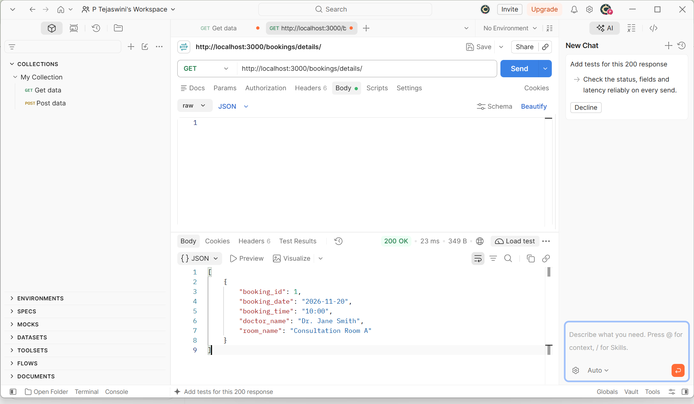
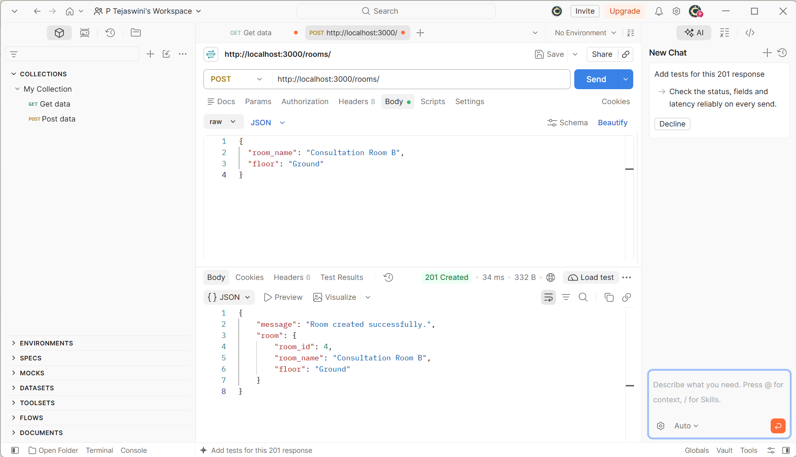
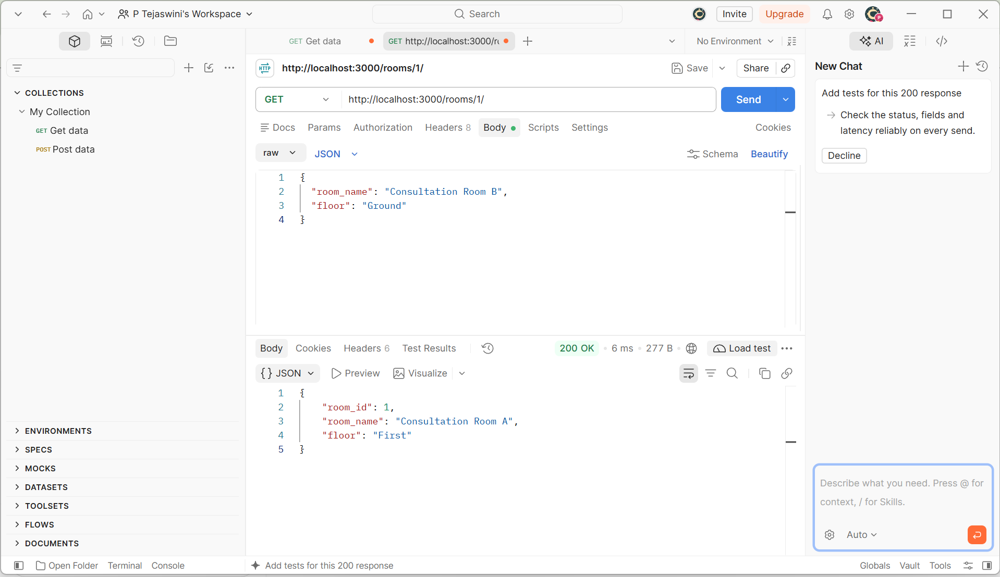
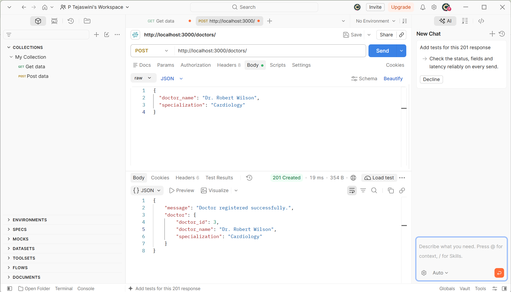

# Group Member 3 Contribution Document

## Student Information
- **Group:** LG 8
- **Name:** Tejaswini
- **Student ID:** 252U1R3071
- **Role:** REST API Developer
- **Assigned Focus Area:** REST Endpoints (Room CRUD Operations, Doctor Endpoints, Booking Endpoints, and SQL JOIN Implementation)

---

> **Collaborative Project Statement:**  
> The ClinicQ Health Centre backend was designed, implemented, and tested as a unified team effort by all six members of Group LG 8. Within this collaborative framework, Tejaswini was assigned primary responsibility for developing the REST API endpoints, implementing CRUD workflows, mapping HTTP status codes, and authoring the mandatory SQL JOIN query.

---

## 1. Assigned Responsibilities
As the REST API specialist for LG 8, Tejaswini's assigned responsibilities included:
1. **Room REST APIs (CRUD Operations in `routes/rooms.js`):**
   - `GET /rooms/` (retrieve all consultation rooms).
   - `GET /rooms/?floor=Ground` (filter rooms by floor).
   - `GET /rooms/:roomId/` (retrieve details of a specific room).
   - `POST /rooms/` (create a new room with HTTP 201 Created).
   - `PUT /rooms/:roomId/` (update an existing room with HTTP 200 OK).
   - `DELETE /rooms/:roomId/` (delete an unused room).
   - **Floor Validation:** Only Ground, First, and Second are accepted. Invalid floor values return HTTP 400 with a message showing the allowed values.
2. **Doctor Endpoints (`routes/doctors.js`):**
   - `GET /doctors/` (list all doctors).
   - `GET /doctors/:doctorId/` (retrieve a single doctor profile).
   - `POST /doctors/` (register a new doctor with HTTP 201 Created).
   - `PUT /doctors/:doctorId/` (update doctor details).
   - `DELETE /doctors/:doctorId/` (delete doctor with referential checks).
      - Validate that doctor_name and specialization are provided as non-empty strings before registration or updating.
3. **Booking Endpoints (`routes/bookings.js`):**
   - `POST /bookings/` (create booking with foreign key verification and conflict rejection).
   - `GET /bookings/` (list all bookings).
   - `GET /bookings/:bookingId/` (retrieve a single booking).
   - `DELETE /bookings/:bookingId/` (cancel / delete a booking).
      - Verify that the selected doctor and room exist before creating a booking.
   - Prevent double-booking by rejecting bookings when the same room or doctor is already scheduled at the same date and time.
4. **Mandatory Multi-Table SQL JOIN Endpoint (`GET /bookings/details/`):**
   - Authoring an SQL `INNER JOIN` linking `bookings`, `doctors`, and `rooms` to output human-readable booking information with doctor and room names.

---

## 2. Key Code Sections & Contributions

### File: `routes/bookings.js` (Mandatory SQL JOIN)
- **Multi-Table SQL JOIN Query:**
  ```javascript
  router.get('/details', (req, res) => {
    const joinQuery = `
      SELECT 
        b.booking_id,
        b.booking_date,
        b.booking_time,
        d.doctor_name,
        r.room_name
      FROM bookings b
      JOIN doctors d ON b.doctor_id = d.doctor_id
      JOIN rooms r ON b.room_id = r.room_id
      ORDER BY b.booking_id ASC
    `;

    db.all(joinQuery, [], (err, rows) => {
      if (err) {
        return res.status(500).json({ error: 'Internal server error while retrieving joined booking details.' });
      }
      return res.status(200).json(rows);
    });
  });
  ```

### File: `routes/rooms.js` (Room CRUD)
- **Parameterized SQL Execution:**
  ```javascript
  // GET single room
  router.get('/:roomId', (req, res) => {
    const { roomId } = req.params;
    db.get('SELECT * FROM rooms WHERE room_id = ?', [roomId], (err, row) => {
      if (err) return res.status(500).json({ error: 'Internal server error.' });
      if (!row) return res.status(404).json({ error: 'Room not found.' });
      return res.status(200).json(row);
    });
  });

  // DELETE room
  router.delete('/:roomId', (req, res) => {
    const { roomId } = req.params;
    // Check bookings and delete
    db.run('DELETE FROM rooms WHERE room_id = ?', [roomId], function (err) {
      if (err) return res.status(500).json({ error: 'Internal server error.' });
      return res.status(200).json({ message: 'Room deleted successfully.' });
    });
  });
  ```

### File: `routes/doctors.js` (Doctor Registration)
- **Doctor Creation:**
  ```javascript
  router.post('/', (req, res) => {
    const { doctor_name, specialization } = req.body;
    db.run(
      'INSERT INTO doctors (doctor_name, specialization) VALUES (?, ?)',
      [doctor_name.trim(), specialization.trim()],
      function (err) {
        if (err) return res.status(500).json({ error: 'Internal server error.' });
        return res.status(201).json({
          message: 'Doctor registered successfully.',
          doctor: { doctor_id: this.lastID, doctor_name, specialization }
        });
      }
    );
  });
  ```

---

## 3. Demonstration & Viva Guide
During the lab evaluation, Tejaswini should demonstrate and explain:
1. **The SQL JOIN Query:** Explain how `INNER JOIN` bridges the foreign keys (`bookings.doctor_id = doctors.doctor_id` and `bookings.room_id = rooms.room_id`) to transform raw integer foreign keys into human-readable strings (`doctor_name`, `room_name`).
2. **Why Parameterized Queries are Essential:** Explain why using placeholder `?` parameters with SQLite protects against SQL Injection attacks, rather than concatenating user input directly into SQL strings.
3. **HTTP Status Code Mapping:** Explain the semantic meaning and reasoning behind status codes:
   - `200 OK`: Successful retrieval, update, or deletion.
   - `201 Created`: Successful creation of a new entity (POST).
   - `400 Bad Request`: Client input validation error.
   - `404 Not Found`: Target entity ID does not exist.
   - `500 Internal Server Error`: Unhandled database driver failure.

---


## 4. Genuine Student Evidence

### Evidence 3.1: SQL JOIN Response

Postman response showing booking details with doctor and room names:





### Evidence 3.2: Room CRUD Operations

Room creation:



Room retrieval:



### Evidence 3.3: Doctor Registration

